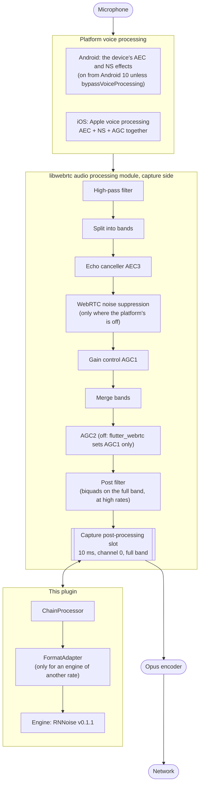

# flutter_webrtc_noise_suppression

A [flutter_webrtc](https://github.com/flutter-webrtc/flutter-webrtc) add-on: noise suppression of the voice an app sends. RNNoise v0.1.1 runs in flutter_webrtc's capture post-processing slot, after the platform's echo cancellation and noise suppression and right before the encoder. Android and iOS. Experimental. The plugin is built so that another engine joins it as a pull request: see "Adding an engine".

## Where it runs



The engine hears the voice after echo cancellation, the platform's noise suppression and gain control, and is the last thing that changes it before the encoder. That is the place an extra denoiser does not hurt echo cancellation; a hook before the processing module (raw microphone samples, as `rtc_rnnoise` on pub.dev takes them) would feed the echo canceller a signal it no longer recognizes.

What sits before the slot, read in the code (libwebrtc of webrtc-sdk `m150_release`, the `150.7871.04` flutter_webrtc 1.6.3 pins; flutter_webrtc 1.6.3):

| Step | Where it is set | What it does |
|---|---|---|
| Platform AEC and NS, Android | flutter_webrtc `MethodCallHandlerImpl.initialize`: `setUseHardwareAcousticEchoCanceler` / `setUseHardwareNoiseSuppressor` from Android 10, `setNoiseSuppressorEnabled(true)` where supported; all off with `bypassVoiceProcessing` | the device's own effects, whatever its maker built |
| Platform voice processing, iOS | flutter_webrtc's `AudioEngine` device module; its topology couples AEC and NS (`AudioEngineDevice::GetPlatformAudioProcessingTopology`) | Apple's AEC, NS and AGC, on or off together |
| WebRTC's own noise suppression | `getUserMedia` adds `googNoiseSuppression: true` and no `noiseSuppressionMode`, so the mode is automatic (`sdk/media_constraints.cc`); `media/engine/audio_processing_controller.cc` then turns the software one on only when the platform's cannot be enabled, at level `kHigh` | where the phone has a noise suppressor of its own, that one ran before the engine, not WebRTC's |
| The processing order | `AudioProcessingImpl::ProcessCaptureStreamLocked` | high-pass, AEC3, NS, AGC1, bands merged, AGC2 (left off), the post filter (cascaded biquads libwebrtc adds by itself at high rates against the artefacts of the processing before), then `capture_post_processor`; after it only the output level statistics, a capture level adjustment flutter_webrtc does not configure, and zeroed frames right after an unmute |

Which platform effects run depends on the phone. Read on two of them during a call (`dumpsys media.audio_flinger`, the input thread's effect chain; 2026-11-04, run-d813a33c2f4fd2056ec45372 and run-a51e62e3e1f0936f785475b2):

| Phone | Capture | Platform effects on the microphone | Noise suppression before the slot |
|---|---|---|---|
| Redmi A5 (Android 15 Go, Unisoc) | `VOICE_COMMUNICATION`, built-in mic, 48 kHz mono | Acoustic Echo Canceler (`sprd cvs`), enabled; the phone has no noise suppression effect at all | WebRTC's own (no platform NS to enable, so the rule above turns it on) |
| Galaxy Tab A SM-T505 (Android 12, Qualcomm) | `VOICE_COMMUNICATION`, back mic, 48 kHz | Acoustic Echo Canceler and Noise Suppression (Qualcomm Fluence), both enabled | Fluence; WebRTC's own is off |

A probe in the app saw the same on the stand through libwebrtc's processing state: noise suppression `SOFTWARE` on the Redmi A5 (no hardware one), `PLATFORM` on the Galaxy Tab A, echo cancellation `PLATFORM` on both. Turning the platform's noise suppression off moved the far end's speech-to-pause gap by -1.8 to +2.6 dB on keyboard, babble, a colleague and a restaurant, within the run-to-run spread (agent-tasks WT-2189, matrix 1).

### How the plugin is wired in

1. **The app** calls `attach()` when its microphone track opens and `detach()` when it stops; a switch in the app's settings decides whether it calls them at all. Nothing goes into `MainActivity` or `AppDelegate`: `GeneratedPluginRegistrant` registers the plugin.
2. **Dart to native.** `WebrtcNoiseSuppressionBridge` sends `attach` with the engine names over the method channel `com.portaone.flutter_webrtc_noise_suppression`.
3. **Engines are made** on the plugin's worker thread from `NoiseSuppressorRegistry`, each wrapped in a `FormatAdapter`.
4. **Into the slot**, back on the main thread. Android: the Flutter engine's own `FlutterWebRTCPlugin` (never `sharedSingleton`), its `audioProcessingController.capturePostProcessing.addProcessor(...)`; flutter_webrtc gave that adapter to the factory as `ExternalAudioProcessingFactory`, which libwebrtc builds into the processing module with `SetCapturePostProcessing`. iOS: `AudioManager.sharedInstance().capturePostProcessingAdapter.addProcessing(...)`, the delegate of the process-wide `RTCDefaultAudioProcessingModule`.
5. **Every 10 ms** on the capture thread libwebrtc calls the slot with channel 0 of the full-band buffer: 480 float samples on the int16 scale at 48 kHz (Android: `ExternalAudioProcessor::Process`, a direct `ByteBuffer` over the native samples; iOS: `RTCAudioBuffer.rawBufferForChannel(0)`). The chain runs each engine in place and the frame goes on to the encoder. The slot input written by `dumpInputSeconds` on a Redmi A5 was that: 48 kHz, 480-sample frames.
6. **Detach** takes the chain out under the adapter's lock, so no frame is in flight when the engines are freed, and logs one line per engine.

On iOS libwebrtc's own adapter of the slot takes its lock with `os_unfair_lock_trylock` and lets a frame through untouched when it cannot (`RTCAudioCustomProcessingAdapter.mm`). That lock is held while the module initializes or releases its delegate (a stream starting, a rate change), not while this plugin attaches: a frame that meets such a moment passes unprocessed.

## Engines

| `WebrtcNoiseSuppressionEngine` | What | Weights | CPU (M5 host, per 10 ms frame) |
|---|---|---|---|
| `rnnoise` (default) | RNNoise v0.1.1 | ~90 KB | ~80 us |

`measure(engine:)` gives the time per frame and the attenuation on the device it runs on: on a Redmi A5 (Android 15 Go) p99 465 us, on a Galaxy Tab A SM-T505 (Android 12) p99 496 us. In a real call, from the detach line, the same engine took p99 1.2 ms per frame on the Redmi A5 and 3.8 ms on the SM-T505, no frame over its 10 ms.

RNNoise main's little model and DeepFilterNet 3 were measured for this slot and not taken (little takes the voice down under babble; DeepFilterNet 3 misses frames on the SM-T505 and costs about 19 MB per ABI). Either can come back as an engine of the plugin, as below.

## Adding an engine

For contributors: an engine is added to the plugin by a pull request. An app picks one of the engines the plugin ships (`WebrtcNoiseSuppressionEngine.rnnoise`) and cannot bring its own: the registry, the format adapter and the test engine are internal.

What the pull request adds:

| Part | Where |
|---|---|
| The engine on Android: an implementation of `NoiseSuppressor` (Java or Kotlin, over JNI if its core is native) | `android/src/main/java/.../`, native code under `android/src/main/cpp` or as a prebuilt `jniLibs` library |
| The engine on iOS: an implementation of `NSPNoiseSuppressor` | `ios/flutter_webrtc_noise_suppression/Sources/NoiseSuppression/`, its C core as a target of `Package.swift` |
| Its name, one line per platform | the `init` block of `NoiseSuppressorRegistry.kt`, the `factories` of `NoiseSuppressorRegistry.swift` |
| Its name in Dart | `static const myEngine = WebrtcNoiseSuppressionEngine._('my-engine');` in `lib/` |
| Its license | `THIRD_PARTY_NOTICES.md` |
| Its check on a device | `example/integration_test`: `measure(engine: ...)` within the 10 ms budget and attenuating white noise |

What it does not touch: `WebrtcNoiseSuppressionPlugin` on either platform, the chain, the detach lines, the threading. In particular:

- **Its format.** An engine that works at another rate or frame length says so (`engineSampleRateHz()` / `engineFrameSize()` on Android, `engineSampleRate` / `engineFrameSize` on iOS; 0 or absent means the slot's own, 48 kHz in 10 ms frames). The add-on puts `FormatAdapter` in front of it: a windowed-sinc low-pass, decimation by a whole factor (48 kHz to 16 kHz is 3), the engine's own frames gathered, interpolation back. That costs one engine frame and the filters in delay (11.6 ms for 16 kHz in 10 ms frames; `measure` reports it as `latencyMs`). A rate 48 kHz does not divide by a whole number is not taken: its frames pass unchanged.
- **Its cost.** The factory runs on the plugin's worker thread, so a model may take its time to load. `process` runs on the capture thread every 10 ms and must not allocate.
- **A chain.** `attach(engines: [a, b])` runs every frame through `a`, then `b`, in place. One chain is in the slot at a time; the next `attach` replaces it, the same chain again is left as it is.

The device tests use an engine of the plugin's own, `test-identity-16k` (16 kHz in 10 ms frames, left as they are), registered only by `registerTestEngines()`, which is `@visibleForTesting`; it is what shows the adapter and a chain work on a phone.

## Inside

| Layer | Where | Knows about |
|---|---|---|
| C core: `noise_suppressor.h` over RNNoise (48 kHz, 480-sample frames), engine chosen at creation | `ios/flutter_webrtc_noise_suppression/Sources/NoiseSuppressionCore` (Android compiles the same files, `android/src/main/cpp`) | nothing |
| The suppressor's interface: `NoiseSuppressor` / `RnnoiseSuppressor` (Android, JNI), `NSPNoiseSuppressor` / `NSPRnnoiseSuppressor` (iOS) | `android/src/main/java`, `ios/.../Sources/NoiseSuppression` | the C core only |
| The add-on: `NoiseSuppressorRegistry` (name to engine), `FormatAdapter` (another rate or frame length), `WebrtcNoiseSuppressionPlugin` with its chain, which takes flutter_webrtc's captured frames and hands them to the engines | `android/src/main/kotlin`, `ios/.../Sources/flutter_webrtc_noise_suppression` | flutter_webrtc and the interface |
| Dart: `WebrtcNoiseSuppressionBridge` (`attach`, `detach`, `measure`) | `lib/` | the channel |

The add-on works with the engines only through their interface and finds them by name, so another engine is another implementation of `NoiseSuppressor` with one registry line, and the add-on does not change. flutter_webrtc is reached through its public interfaces: `AudioProcessingAdapter.ExternalAudioFrameProcessing` on Android, `ExternalAudioProcessingDelegate` and `AudioManager.capturePostProcessingAdapter` on iOS. Nothing is looked up by name, and nothing goes into the app's `MainActivity` or `AppDelegate`: the plugin is registered by `GeneratedPluginRegistrant` like any other.

## Use

```yaml
dependencies:
  flutter_webrtc_noise_suppression:
    git:
      url: https://github.com/SERDUN/flutter_webrtc_noise_suppression.git
      ref: <commit>
```

```dart
const bridge = WebrtcNoiseSuppressionBridge();
await bridge.attach(); // true: RNNoise is in the slot; every call's microphone is denoised
await bridge.detach(); // true: it was there and is out
```

`attach` returns false when flutter_webrtc has not built its factory yet (it does on its first use: `getUserMedia`, `createPeerConnection`), an engine cannot be created, or a later `attach` or a `detach` came while its engines were being created (they are created on a worker thread and go into the slot on the main one); the audio is then left as it was. An engine the native side does not have fails it with `PlatformException` `unknown_engine`. Attach when the microphone track opens and detach when it stops.

The native side logs a line on attach and one per engine on detach (logcat tag `WebrtcNoiseSuppression`, os_log subsystem `com.portaone.flutter_webrtc_noise_suppression`): the chain and how long its engines took to create, then each engine's frames and their time in the call (the detach line is from a call on a Redmi A5; the bracket is in this version's form):

```
attached rnnoise 0.1.1 create_ms=<ms>
detached: rnnoise 0.1.1 processed=22581 unchanged=0 mean_us=818 p99_us=1200 max_us=3757 over_10ms=0 [initialize(48000, 1)][rnnoise: PROCESSED at frame 1 (480 samples, 3 bands)]
```

`unchanged` counts frames the engine could not take (another rate or length), left as they were; the percentile is read from 200 us buckets; `over_10ms` is the frames that took longer than the 10 ms they hold. The bracketed part is what the slot announced and each engine's result whenever it changed.

```dart
final m = await bridge.measure(); // 3 s of white noise through a fresh engine, outside the slot
print(m); // rnnoise 0.1.1: mean 331 us, p99 465 us, attenuation 15.1 dB
```

Diagnostics, Android only: `attach(dumpInputSeconds: 300)` keeps the first that many seconds of what reaches the slot, before the suppressor, in a buffer allocated at attach, and writes it on detach as a 48 kHz 16-bit WAV, `slot-input-<ms>.wav`, into the app's external files directory (`adb pull /sdcard/Android/data/<package>/files/...` reads it from a release build). The file stays until it is removed.

## Requirements

`flutter_webrtc: ^1.6.3`. The capture slot, the Android controller's accessor and the SPM `WebRTC` product the plugin uses are flutter_webrtc's public API (checked at `v1.6.3`; the slot itself is there since `v1.0.0`).

## Traps

- **Android engines.** Each Flutter engine has its own flutter_webrtc plugin. Each engine also gets its own instance of this plugin, which reaches the flutter_webrtc of that engine, never `FlutterWebRTCPlugin.sharedSingleton`: that names the engine created last, and in an app with background engines (push, call services) it may be one whose factory is never initialized.
- **Android libwebrtc.** `AudioProcessingAdapter` extends libwebrtc's `ExternalAudioProcessingFactory.AudioProcessing`, and flutter_webrtc takes libwebrtc as `implementation`, so `android/build.gradle` names it `compileOnly` at upstream 1.6.3's version (`io.github.webrtc-sdk:android:150.7871.04`). Only the `AudioProcessing` interface is used, and the app's flutter_webrtc brings the libwebrtc that runs.
- **iOS is process-wide.** flutter_webrtc keeps one `AudioManager` for the process: one attached chain covers every Flutter engine.
- **ART before the JIT.** The first frames through a fresh format adapter took up to 12 ms on a Galaxy Tab A (SM-T505) against 0.5 ms once compiled. The plugin runs the adapter over a second of silence once per process, on the worker, before an adapted engine reaches the slot.
- **Swift in debug builds.** Plain Swift loops over arrays took 2.5 ms a frame on an iPhone in a debug build; the iOS adapter's filters run on Accelerate (`vDSP_dotpr`) over flat buffers instead, 0.2 ms.
- **The rate.** A processor added while the microphone already runs is never told the rate; the length of the first frame (10 ms) gives it.
- **iOS log level.** The two lines a call are os_log's default level: on an iPhone the log stream dropped info lines of this subsystem.
- **The example's Xcode project.** `flutter create --template=plugin` puts a reference to `ios/flutter_webrtc_noise_suppression` into the example's Runner project, for editing. Xcode then resolves that original `Package.swift`, whose `../flutter_webrtc` exists only in the copy Flutter writes to `build/ios/SourcePackages` (with the paths rewritten to the hashed names git dependencies get), and the build stops with `cannot be accessed`. The reference is removed here; apps never had it.
- **The example's build directory.** With Swift Package Manager Flutter copies the whole plugin directory, `example/` included, into `example/build/ios/SourcePackages`, so every iOS build nests the copy of the one before it, until a build stops with `Failed to copy plugin ... Assertion failed: (pathbufsz > fts_pathlen)`. Run `flutter clean` in `example/` when that happens. An app that takes the plugin from git has no such directory in its copy.
- **RNNoise's global.** RNNoise keeps its FFT state in a global named `common`; every build defines `common=ns_rnnoise_common` so it cannot collide with another library in the process.
- **RNNoise's first frame.** RNNoise builds its FFT tables with `malloc` on the first frame; `ns_create` runs one frame of silence so that happens off the audio thread. `rnnoise_init` on a live state leaks its buffers; `ns_reset` replaces the state instead (it allocates, so not per frame).
- iOS 15.0 is the lowest target (Xcode 27 accepts nothing older). The iOS build goes through Swift Package Manager (`ios/flutter_webrtc_noise_suppression/Package.swift` names `../flutter_webrtc`, the sibling Flutter lays out); the podspec has not been built.

## Checks

```sh
make test                 # the C core on the host: white noise attenuated by more than 10 dB, bad frames untouched
flutter analyze && flutter test
cd example/android && ./gradlew :flutter_webrtc_noise_suppression:testDebugUnitTest   # the format adapter and the registry on the JVM (JDK 17-21)
cd example && flutter test integration_test   # on a device: attach and detach, a chain with the test engine, an unknown engine, an attach overtaken, measure of both
cd example/ios && xcodebuild test -workspace Runner.xcworkspace -scheme Runner \
  -destination 'platform=iOS Simulator,name=<iPhone>' -only-testing:RunnerTests
```

## License

BSD 3-Clause, see [LICENSE](LICENSE). RNNoise is under its own BSD 3-Clause license: [THIRD_PARTY_NOTICES.md](THIRD_PARTY_NOTICES.md).
